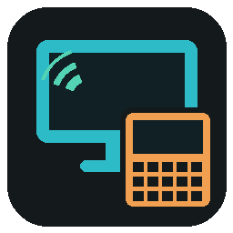

# CXL Remote

Remote desktop for the **Cardputer XL**: an [M5Stack Cardputer-ADV](https://docs.m5stack.com/en/core/Cardputer) with an external **ILI9341 320x240** panel on the EXT header (same wiring as [cardputer-xl](https://github.com/szuszjan/cardputer-xl)).

Your PC's screen goes to the big panel and **your PC's sound plays on the Cardputer's speaker**. The Cardputer's keyboard drives your PC. Typing, shortcuts, mouse, zoom and multiple monitors all work.

- **External ILI9341**: the PC screen.
- **Built-in Cardputer screen**: status HUD (KEYBOARD/MOUSE mode, zoom, fps, KB/s, key hints).

The PC does the heavy lifting: it captures the screen, scales it to 320x240, overlays the cursor, finds the regions that changed and JPEG-encodes them.

The Cardputer's two cores split the rest:
- core 0 receives the stream in the background;
- core 1 decodes tiles with JPEGDEC while the previous block is already going to the panel over SPI DMA;
- an audio task plays the PC sound from a jitter buffer.

When a lot of the screen moves (video, scrolling), the server sends those tiles at a lower quality. Once the picture holds still, it re-sends them sharp.

## Quick start

1. **PC**: download `CXLRemoteServer.exe` from [Releases](../../releases) and run it. It needs no install and no Python. Windows SmartScreen may warn about an unsigned app (*More info → Run anyway*). When the firewall asks, allow **private networks only**.
2. **Cardputer**: flash `cxl-remote-firmware-merged.bin` at `0x0` (M5Burner, or `esptool.py write_flash 0x0 cxl-remote-firmware-merged.bin`).
3. On the Cardputer, pick a Wi-Fi network. Then pick your PC from the list (found automatically) and enter the **PIN** shown in the server window, once.

The Cardputer remembers the PC and reconnects to it on the next boot.

## Server window



- Live preview of exactly what the Cardputer panel shows
- PIN: copy, generate a new one, hide, or turn PIN off (trusted networks only)
- Live status: fps, KB/s, zoom level, monitor, connection time
- **Monitor** picker, **Keep aspect / Stretch to fit**, **quality** (Fast / Normal / Sharp), **max FPS**
- **Send PC sound** to the Cardputer speaker (WASAPI loopback of the default output, 24 kHz mono)
- **View only**: show the screen but ignore the Cardputer's keyboard and mouse
- Disconnect the Cardputer, start/stop the server, log

Settings sync both ways: what you change on the Cardputer shows up in the window, and vice versa. They are stored in `%USERPROFILE%\.cxl_remote.json`.

Windows does not let injected input reach **elevated (admin) windows** unless the server also runs as administrator.

## Keys

| Keys | Action |
|---|---|
| typing | real key down/up events, with Shift/Ctrl/Alt as real modifiers: Ctrl+C, Ctrl+Shift+T, Alt+Tab… |
| Ctrl+Alt+letter | AltGr characters (e.g. Polish ą ę ś ł…) |
| Fn + `;` `.` `,` `/` | arrows |
| Fn + `` ` `` | Esc |
| Fn + `1`…`0` `-` `=` | F1…F12 |
| Fn + Del | Delete |
| Fn + `[` `]` | Page Up / Page Down |
| Fn + H / E | Home / End |
| Fn + I / P / M | Insert / PrintScreen / context Menu |
| Opt (tap) | Windows key |
| Opt + key | Win + key (Win+R, Win+D, Win+E…) |
| **Opt + Space** or **G0** button | toggle MOUSE / KEYBOARD mode |
| Opt + `=` / `-` | zoom in / out (view follows the pointer) |
| Opt + `0` | whole screen; press again to toggle **FIT ↔ STRETCH** |
| Opt + `1` | next monitor |
| Opt + `9` | image quality |
| Opt + `8` | backlight |
| Opt + Enter | full refresh |
| Opt + `[` / `]` | volume down / up |
| Opt + `\` | sound on / off |
| Opt + `` ` `` | disconnect (back to the server list) |

**MOUSE mode** controls:
- `;` `.` `,` `/` move the pointer (it accelerates; hold Shift for precision).
- Enter or Space is the left button; hold it to drag.
- `\` is the right button, `'` the middle button, `[` `]` the scroll wheel.
- All other keys still type.

**Zoom levels:**
- FIT shows the whole monitor with its aspect kept (1920x1080 → 320x180, with bars).
- STRETCH fills all 320x240.
- After that come 1:4, 1:3, 1:2, 1:1.5 and 1:1 (pixel for pixel).

## Building from source

**Firmware** (`CardputerXLRemote.cpp`; the `.ino` is just a stub):
- Arduino-ESP32 3.x, FQBN `esp32:esp32:m5stack_cardputer`.
- Libraries: M5Cardputer (its M5GFX also drives the external panel, on SPI2 with DMA), JPEGDEC.

```bash
arduino-cli compile --upload -p COM25 --fqbn esp32:esp32:m5stack_cardputer .
```

If CardputerXL already ran on the unit, the sketch reuses its saved Wi-Fi network, rotation and brightness from NVS. Flashing just the app keeps NVS. The merged `.bin` erases it.

**Server** (Python 3.9+):

```bash
pip install -r server/requirements.txt
python server/cxl_remote_gui.pyw      # window
python server/cxl_remote_server.py    # console only (--port --pin --fps --stretch --no-auth -v)
```

Rebuilding the exe: `pip install pyinstaller`, then run `server/build_exe.bat`. On macOS and Linux the server uses `pynput` for input (untested).

## Wiring

| ILI9341 | Cardputer-ADV |
|---|---|
| CS | GPIO 5 |
| DC | GPIO 13 |
| RST | GPIO 15 |
| MOSI | GPIO 3 |
| SCK | GPIO 6 |
| LED / backlight | GPIO 39 (PWM) |
| optional vibration motor (IN) | GPIO 1 |

## Protocol & security

Protocol v3 is documented at the top of `server/cxl_remote_server.py`.
- Discovery is a UDP broadcast on port 5901; the session runs over TCP 5901.
- Screen updates are JPEG tiles on a 32x16 grid, merged into rectangles. At most 2 frames are in flight, each acknowledged by the Cardputer.
- Sound travels on the same connection as 20 ms blocks of 24 kHz mono mu-law.
- The Cardputer authenticates with an HMAC-SHA256 challenge keyed by the PIN, so the PIN never crosses the network.
- The screen stream itself is **not encrypted**. Use it on your home network only.
